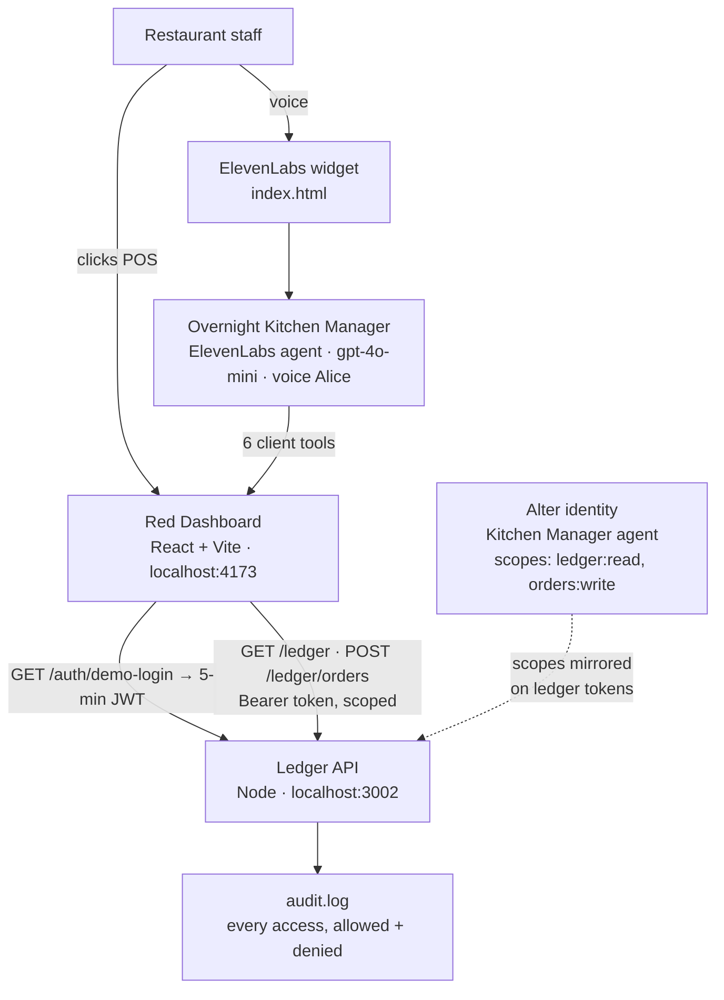

# Overnight Kitchen Manager

**An AI coworker you can actually hire. It owns prep and ordering for a restaurant.**

The Kitchen Manager tracks every ingredient, scores itself on food cost and waste, can 86 a dish, and builds tomorrow's grocery list at close of day. It never buys anything on its own — a human always presses BUY.

Built by Team 27 at the YC × ElevenLabs Hackathon, University of Waterloo, Nov 22, 2026.

## What it does

**Service (all day).** Staff press a dish on the POS. The recipe deducts from inventory live, a receipt is logged, and the scoreboard updates food cost, waste, and profit. Salmon only has 3 portions — after the third order the dish 86s itself off the menu board.

**Voice (all day).** Talk to the manager through the ElevenLabs voice widget: 86 a dish, change a price, add a dish, add a supplier, or ask for the grocery list.

**End Sales (close of day).** One button tallies what was used, what is left, the most-used ingredient, and the most expensive barely-used ingredient. Then it builds tomorrow's grocery list in three parts — daily perishables, bulk (3–4 days), weekly — using registry prices first, then a seeded 20 km supplier search. BUY shows a confirmation only and never places an order.

**Demo data.** 6 seeded dishes, low eggs, one expensive barely-used ingredient, a supplier registry with custom suppliers and rates, and seeded 20 km prices.

## The ledger books: what the agent reads, what it updates, and how Alter secures it

The ledger is the restaurant's book of record — inventory on hand, every order, every price. The Kitchen Manager is the only agent allowed to touch it, and it does so through its own identity.

**What it reads.** Before it answers anything, the agent reads the ledger: current stock of every ingredient, today's orders, supplier prices. That is how it knows the salmon only has 3 portions left, or that eggs are low.

**What it updates.** Every sale updates the books live:
- Tapping a dish on the POS deducts that recipe's ingredients from inventory and logs a receipt.
- When a dish sells out, the agent 86s it — the menu board updates and the dish can no longer be ordered.
- By voice, the agent can update a price, add a dish, or add a supplier to the registry.
- At End Sales it writes the close-of-day tally and the next grocery list back to the ledger as orders.

**How Alter secures it.** The agent's identity lives in Alter, application "Kitchen Manager", holding exactly two scopes: `ledger:read` and `orders:write`. Nothing else — no money movement, no access to anything outside the ledger. Each ledger call carries a short-lived 5-minute token with only those scopes. No token gets a `401`, the wrong scope gets a `403`, and every access — allowed or denied — is written to `audit.log`. And the agent still never buys: it proposes the order, a human presses BUY.

## Architecture



## Tools used

| Tool | What it does here |
|---|---|
| **ElevenLabs Conversational AI** | The voice agent. Agent "Overnight Kitchen Manager", LLM gpt-4o-mini, voice Alice. 6 client tools: `eighty_six_dish`, `add_supplier`, `update_price`, `add_dish`, `get_grocery_list`, `request_order_approval`. Embedded as a plain ConvAI widget in `app/index.html`. |
| **Alter** | The agent's identity. Application "Kitchen Manager" with an agent scoped to `ledger:read` + `orders:write`. No money movement, no other permissions. |
| **React + Vite + TypeScript** | The red dashboard: POS, menu board, live scoreboard, chart, receipt log, End Sales panel, Alter security card. `app/src/App.tsx` + `app/src/App.css`. |
| **Ledger API (Node, zero dependencies)** | `ledger-api/ledger-api.js` on port 3002. Holds inventory and orders. `GET /ledger` reads, `POST /ledger/orders` writes. |

## How it is secured

1. **The agent has its own identity.** In Alter, the Kitchen Manager agent holds exactly two scopes: `ledger:read` and `orders:write`. It cannot move money or touch anything else.
2. **Short-lived scoped tokens.** The ledger mints a 5-minute JWT (`GET /auth/demo-login`, subject `kitchen-manager-agent`) carrying only those two scopes. Every ledger call needs the token as a Bearer header.
3. **Deny by default.** No token → `401`. Token without the right scope → `403`. The dashboard's Alter card shows this live: it fetches the ledger with the minted token, and falls back gracefully if the API is not running.
4. **Everything is audited.** Every ledger access, allowed or denied, is appended to `audit.log` with a timestamp.
5. **A human approves every purchase.** The agent proposes orders; only a human pressing BUY confirms one. The agent never buys on its own.
6. **Production mode included.** The ledger also ships a real-OIDC mode (RS256 via JWKS, `OIDC_ISSUER` / `OIDC_AUDIENCE` env vars). The demo runs in demo-token mode.

## Run it

```bash
# Terminal 1 — the ledger
cd ledger-api && node ledger-api.js

# Terminal 2 — the dashboard
cd app && npm run build && npm run preview -- --port 4173 --host 127.0.0.1
```

Open http://localhost:4173/.

## Repo layout

```
app/                  React + Vite dashboard (App.tsx, App.css, index.html with the ElevenLabs widget)
ledger-api/           Ledger API (ledger-api.js, README.md)
```

## Team 27

Zirui Zhao, Jawed Jamshid, Baraa Al alnakwa, Shivoy Malhotra.
